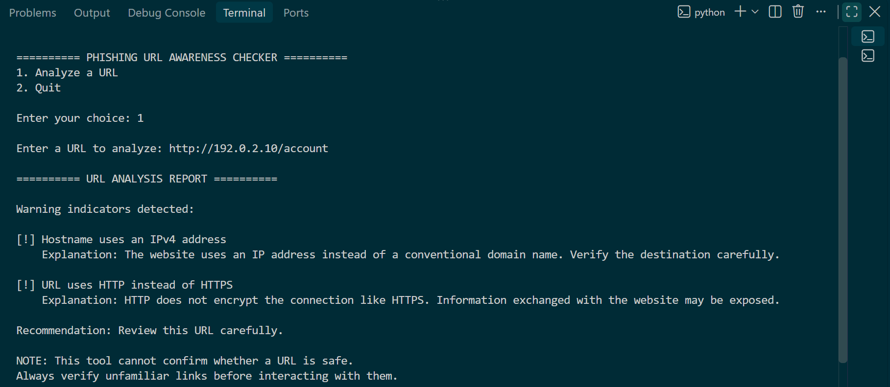
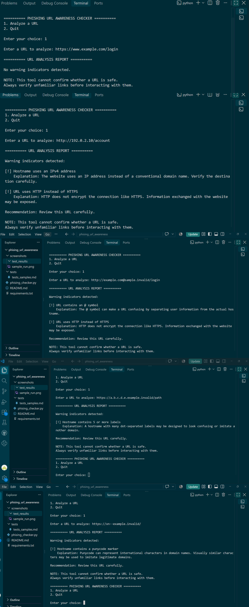

# EWB Phishing URL Awareness Checker

## Overview

Phishing is a trick in which fake links or messages are used to make people reveal passwords, OTPs or payment details. This project is a beginner-friendly Python command-line tool that reads the text of a URL and reports common warning signs, with a short explanation for each one.

**Important:** The tool only reads URL text. It never opens a URL, and it cannot prove that a link is safe or malicious.

## Features

The application performs six detection checks:

1. **@ Symbol Detection:** Flags URLs containing the `@` symbol.
2. **URL Length Detection:** Flags URLs longer than 100 characters.
3. **IPv4 Address Detection:** Flags hostnames written as an IPv4 address.
4. **Hostname Label Detection:** Flags hostnames with five or more dot-separated labels.
5. **Punycode Detection:** Flags hostname labels that begin with `xn--`.
6. **HTTP Detection:** Flags URLs that use HTTP instead of HTTPS.

Improvements:

- Interactive menu with a quit option (analyse many URLs without restarting)
- A plain-language explanation for every warning
- A "REVIEW CAREFULLY" summary with the number of warnings found
- Input validation that rejects empty, malformed and unsupported input without crashing

## Requirements

Python 3.10 or later. No extra packages (`requirements.txt` contains only a comment).

## How to Run

Windows:

```bash
python phishing_checker.py
```

Mac / Linux:

```bash
python3 phishing_checker.py
```

Choose option `1`, type a sample URL, and choose option `2` to quit.

## Example Output

```text
========== PHISHING URL AWARENESS CHECKER ==========
Text checks only - this program does not open URLs.
1. Analyze a URL
2. Quit

Enter your choice: 1

Enter a sample URL to analyze: http://192.0.2.10/account

========== URL ANALYSIS REPORT ==========

Warning indicators detected:

[!] Hostname uses an IPv4 address
    Explanation: The website uses an IP address instead of a conventional domain name. Verify the destination carefully.

[!] URL uses HTTP instead of HTTPS
    Explanation: HTTP does not encrypt the connection like HTTPS. Information exchanged with the website may be exposed.

REVIEW CAREFULLY: 2 warning sign(s) found.

NOTE: This tool cannot confirm whether a URL is safe.
Never enter passwords from unexpected links.
```

## Testing

| # | Input | Expected | Actual | Result |
|---|-------|----------|--------|--------|
| 1 | https://www.example.com/login | No warning signs | No warning indicators detected | PASS |
| 2 | http://192.0.2.10/account | IP address + HTTP | IPv4 hostname + HTTP warnings | PASS |
| 3 | http://example.com@sample.invalid/login | @ symbol + HTTP | @ symbol + HTTP warnings | PASS |
| 4 | https://a.b.c.d.e.example.invalid/path | Many hostname segments | 5 or more labels warning | PASS |
| 5 | https://xn--example.invalid/ | Punycode-style hostname | Punycode marker warning | PASS |

Ten additional edge-case tests (empty input, missing scheme, malformed hostname, invalid port, unsupported scheme, whitespace in hostname, uppercase scheme, long URL, invalid IPv4 values) are recorded in `tests/test_samples.md`.

## Screenshots




## Improvements

1. **Menu loop with quit** - The program returns to the menu after each analysis, so several URLs can be checked in one session. Tested by analysing multiple URLs in one run and quitting with option 2.
2. **Warning explanations and summary** - Each warning prints a short reason, followed by a "REVIEW CAREFULLY" count, so beginners understand why a clue matters. Tested by re-running all five sample URLs.
3. **Safe input handling** - Empty input, unsupported schemes, invalid ports, spaces in hostnames and broken addresses such as `http://[bad` are rejected with a message instead of crashing. A URL typed without a scheme is analysed as `http://` and the user is told. Tested with the edge cases in `tests/test_samples.md`.

## Limitations

- The tool analyses URL text only.
- It does not visit websites, scan for malware or use threat-intelligence databases.
- Warning signs are clues, not proof of malicious intent.
- No warnings does NOT mean a URL is safe (for example, `https://secure-login.example.invalid` produces none).
- An @ symbol anywhere in the URL is flagged, including in a query string, so false positives are possible.
- Only the `xn--` marker is checked, so look-alike characters typed directly in a hostname are not detected.

## Ethical Use

This project is for cybersecurity awareness and education. Only sample URL strings are used for testing. The tool does not visit websites, collect credentials or send data anywhere. Do not use it to deceive anyone or to test websites without permission.

## Project Structure

```text
phishing-url-awareness/
├── screenshots/
│   ├── sample_run.png
│   └── test_results.png
├── tests/
│   └── test_samples.md
├── phishing_checker.py
├── README.md
└── requirements.txt
```

## Author

Syed Mohammed Khadri, Cybersecurity Internship, EWB Courses

Last updated: November 2026